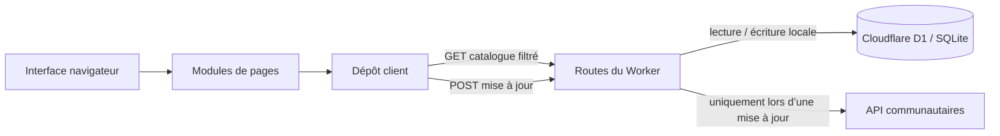

# Architecture de Grand Line

## Vue d’ensemble

## Répertoires

| Répertoire | Rôle |
| --- | --- |
| `app/` | Coque de la page et routes Worker. |
| `app/api/catalog/` | Lit les fiches et limite les résultats à l’arc choisi. |
| `app/api/sync/` | Récupère les sources par pages et met à jour D1. |
| `db/` et `drizzle/` | Schéma Drizzle et migration initiale SQLite. |
| `content/` | Arcs, fiches éditoriales, chronologies de personnages, accomplissements d’équipages et notices de bateaux. |
| `content/character-lore.json` | Profils, faits marquants et historiques de primes avec leur chapitre de révélation. |
| `content/crews.json` | Présentation des équipages, composition et accomplissements datés. |
| `content/ships.json` | Notices de bateaux, liens d’équipage et moments datés filtrés selon l’arc. |
| `public/fruit-lore.json` | Descriptions développées et détenteurs connus avec leur repère de révélation. |
| `public/modules/` | Dépôt navigateur et vues d’accueil, de carte, d’index, de fiches et de collections. |
| `public/app.js` | Point d’entrée : navigation par URL, progression et actions globales. |

## Modèle de données

- `arcs` associe un identifiant stable à une saga et aux plages manga/anime.
- `characters` conserve nom, portrait, première apparition, arc, source et résumé sûr.
- `devil_fruits` conserve nom, modèle, type, image, statut canonique et arc d’apparition.
- `affiliations` décrit équipages, familles et organisations.
- `affiliation_members` garde le rôle et l’arc d’apparition de chaque lien personnage-équipage.
- `ships` conserve les bateaux du catalogue, leur visuel, leur première apparition et leur affiliation source.
- `content/character-lore.json` enrichit chaque fiche de personnage; le catalogue ne renvoie que les descriptions, faits et primes connus jusqu’au chapitre de l’arc choisi.
- `content/crews.json` conserve les présentations et les accomplissements d’équipage avec leur chapitre de révélation.
- `content/fruits-timeline.json` relie les fruits mineurs et les pouvoirs non nommés à leur premier repère manga lorsqu’une source le permet.
- `public/fruit-lore.json` complète le catalogue avec les capacités, les utilisateurs successifs et leur chapitre de révélation; les données restent séparées pour pouvoir les actualiser sans migration D1.
- La synchronisation garde les images de One Piece API en priorité et recherche une image d’infobox sur le wiki Fandom quand la source principale n’en fournit pas. Les cartes affichent une illustration vectorielle lorsque les deux sources n’ont aucun visuel.
- `episodes` et `chapters` conservent les données du guide avec leur source originale.
- `sync_state` évite les mises à jour répétées et affiche la date de synchronisation.

Les tables ont des index sur les noms et arcs pour que le filtre reste rapide. Les références et les images sont importées dans D1; le navigateur ne télécharge pas l’encyclopédie à chaque démarrage.

## Règle anti-spoiler

Le navigateur enregistre localement l’arc choisi. Chaque requête de catalogue envoie l’identifiant de cet arc; l’API D1 ne renvoie que les personnages, groupes, membres et fruits datés avant ou pendant cette progression. Une entrée sans date de première apparition n’est pas incluse dans la réponse. Les membres ont un arc propre, distinct de celui de leur équipage.

Les transformations de nom comme les alias, les révélations progressives de grades et les types de fruits restent gérés par les fiches éditoriales locales. Les détenteurs de fruits sont filtrés selon leur chapitre de révélation, séparément de la première apparition du fruit. Les pouvoirs ou affiliations déduits mais non confirmés sont indiqués comme incertains.

Les fiches d’équipage, de bateau, de personnage et de fruit sont rendues par leurs modules respectifs. Les bateaux, leurs événements et leurs associations sont filtrés par chapitre avant d’être envoyés au navigateur. Les routes `#equipage/...`, `#bateau/...`, `#personnage/...` et `#fruit/...` permettent les liens directs et l’historique précédent/suivant; elles recherchent uniquement dans le catalogue déjà filtré par progression.

`public/modules/map.js` contient les repères cartographiques et les fiches courtes de lieux. Chaque entrée porte l’identifiant d’un arc de première découverte. Le module filtre cette liste avant de produire les marqueurs, résultats de recherche, filtres et fiches; une route `#lieu/...` inconnue ou non débloquée affiche un écran générique. La carte s’appuie sur la progression locale et ne contacte pas de source externe. Son dessin SVG est un schéma original, sans coordonnées à l’échelle; les points d’îles sont des repères d’itinéraire, pas des positions géographiques canons établies.

## Chemin de mise à jour

1. Le navigateur appelle `POST /api/sync` seulement après clic sur « Mettre à jour ».
2. Le Worker récupère personnages, fruits, bateaux et affiliations avec pagination; il récupère aussi les listes d’épisodes et de chapitres.
3. Les entrées sont mises à jour par identifiant dans D1; les erreurs d’une source laissent ses anciennes données intactes.
4. Les associations d’équipage sont recalculées à partir des affiliations documentées et des fiches éditoriales.
5. Le navigateur recharge les données locales filtrées pour l’arc de lecture.

Un délai de deux minutes empêche les clics répétés de relancer plusieurs imports identiques. Les images sont chargées en différé dans les cartes.

## Performance

- Aucun appel vers un service tiers lors de l’affichage initial.
- La requête de catalogue initiale ne lit que les fiches; épisodes et chapitres sont chargés lorsque la page du guide s’ouvre. Les réponses du guide exposent des champs compacts au lieu du JSON source complet.
- Pas de pagination massive de plusieurs milliers de personnages au démarrage : l’index charge jusqu’à 500 fiches sûres, puis lit les pages suivantes quand l’utilisateur demande « Afficher plus ».
- Les listes sont triées et filtrées en base; les portraits des cartes sont chargés à la demande.
- Les préférences restent en `localStorage`; le contenu durable est dans D1.

