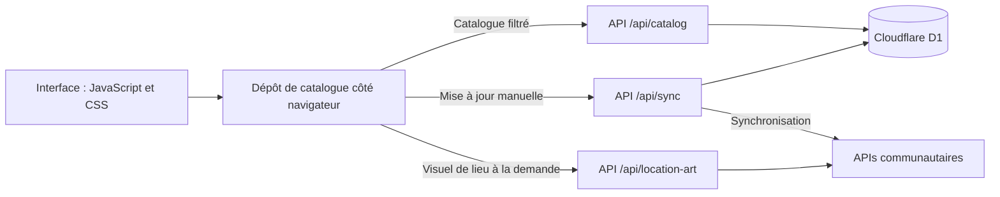

<div align="center">
  
  <h1>Grand Line</h1>
  <p><strong>Le wiki One Piece qui garde le cap.</strong></p>
  <p>Explore le monde, retrouve les personnages et suis les indices de l’histoire<br />au rythme de l’arc que tu as terminé.</p>
</div>

<p align="center">
  
</p>

## Le projet

**Grand Line** est une encyclopédie francophone de One Piece pensée pour accompagner une lecture ou un visionnage en cours. Choisis ton dernier arc terminé : les catalogues et les fiches suivent cette progression pour éviter d’afficher la suite par inadvertance.

L’application réunit plusieurs façons d’explorer l’univers : une carte schématique, un guide épisodes et chapitres, des fiches de personnages, d’équipages et de navires, les Fruits du Démon, les lames, les institutions et un carnet des ponéglyphes.

## Ce qu’on peut explorer

| **Le monde** | **Le récit** | **Les archives** |
| --- | --- | --- |
| Carte des lieux découverts, avec recherche et fiches par île. | Repères entre arcs, chapitres et épisodes. | Ponéglyphes et progression des Road Ponéglyphes dans un carnet personnel. |
| **Les personnages** | **Les équipages** | **Les collections** |
| Fiches progressives, affiliations, rôles et primes connues. | Membres, accomplissements et navires associés. | Fruits du Démon, 26 fiches de lames et favoris. |

Les champs de recherche filtrent les catalogues de leur page ; la carte et les favoris proposent aussi leurs propres filtres. L’arc choisi, les favoris et les annotations du carnet restent enregistrés sur l’appareil.

## Un wiki qui suit ta progression

1. Choisis le dernier arc que tu as terminé, ou le mode débutant.
2. Les listes, recherches, fiches et événements s’ajustent à ce repère.
3. Avance ton repère quand tu es prêt à découvrir la suite.

Les entrées du catalogue stockées dans D1 sont filtrées par l’API selon le chapitre de l’arc choisi. Les fiches éditoriales locales suivent aussi des dates de révélation pour dévoiler progressivement certains détails. La carte est volontairement schématique : elle indique un itinéraire, pas des coordonnées canoniques à l’échelle.

> Le filtre anti-spoilers est un garde-fou de navigation. Comme le dépôt contient des données publiques côté navigateur, il ne constitue pas un verrouillage des informations pour une personne qui inspecte le code ou les ressources.

## Comment ça fonctionne



Le catalogue courant est lu dans D1, sans requête d’encyclopédie externe. Les APIs communautaires sont sollicitées lors d’une mise à jour et à la demande pour chercher les visuels de lieux absents du cache. Le guide détaillé se charge à son ouverture et l’index des personnages se parcourt par pages.

### Technologies

- **Interface :** JavaScript modulaire, CSS et coque React via Vinext.
- **Serveur :** Vinext, Vite et Cloudflare Workers.
- **Données :** Cloudflare D1 (SQLite), Drizzle et fichiers JSON éditoriaux.
- **Synchronisation :** One Piece API pour le catalogue, et API One Piece pour les repères anime/manga.

Pour le détail des routes, du schéma de données et des règles de filtrage, consulte [ARCHITECTURE.md](ARCHITECTURE.md).

## Démarrer le projet

### Prérequis

- Node.js **22.13 ou supérieur**
- npm
- Une liaison Cloudflare D1 `DB` pour utiliser le catalogue et ses routes API

### En local

```bash
npm ci
npm run dev
```

Ouvre ensuite [http://localhost:5173](http://localhost:5173). Les routes de données nécessitent une liaison D1 `DB` et les migrations SQL de `drizzle/` appliquées à cette base. Une fois la base initialisée, lance **Mettre à jour** dans l’application pour synchroniser les sources.

### Commandes utiles

```bash
npm run lint                 # analyse ESLint
npm run build                # build de production
npm run db:generate          # génère une migration après une modification du schéma
node scripts/test-blades.mjs # vérifie le catalogue et ses frontières anti-spoilers
```

## Organisation du dépôt

| Chemin | Contenu |
| --- | --- |
| `app/` | Coque de l’application et routes API. |
| `public/modules/` | Vues JavaScript pour la carte, le guide, les fiches et les collections. |
| `public/styles.css` et `public/blades.css` | Styles de l’interface. |
| `content/` | Arcs, fiches éditoriales et chronologies de révélation. |
| `db/` et `drizzle/` | Schéma D1 et migrations SQL. |
| `worker/` | Entrée Cloudflare Worker. |
| `ARCHITECTURE.md` | Flux de données et règles anti-spoilers détaillés. |

## Sources et limites

Les données de référence et les correspondances sont issues de sources communautaires, qui peuvent contenir des erreurs ou des écarts entre manga et anime. Les détails disponibles dans l’application sont aussi présentés avec leurs sources.

- [Documentation One Piece API](https://www.onepieceapi.com/documentation) — personnages, affiliations, images, fruits et navires.
- [API One Piece](https://documentation.api-onepiece.com/) — repères entre épisodes, chapitres et tomes.
- [One Piece Wiki — Fruits du Démon](https://onepiece.fandom.com/wiki/Category:Devil_Fruits) — vérifications éditoriales.
- [Liste communautaire des Fruits du Démon](https://www.reddit.com/r/OnePiece/comments/1gkr07k/devil_fruit_list/) — point de départ pour certaines chronologies.

Grand Line est un projet de fan indépendant, sans affiliation à Eiichiro Oda, Shueisha ou Toei Animation. Les personnages, marques et images de One Piece appartiennent à leurs ayants droit. Une licence logicielle n’est pas encore publiée dans ce dépôt ; aucune autorisation de réutilisation du code ou des contenus ne doit être déduite de sa présence sur GitHub.
